# Cultural Merch Designer｜主体驱动文创设计 Skill

面向景点、景物、植物、动物、器物与原创 IP 的文创设计 Skill。先核验真实主体，再从产品、材质、工艺、结构和使用场景五个维度建立低同质化方案，兼顾视觉表现、成本与量产可行性。

> **许可说明：**允许个人非商业使用；任何商业用途均需事先联系作者取得书面授权。详见 [`LICENSE.md`](LICENSE.md)。

## 最新精选案例｜昆明蓝楹花

本组先以真实摄影和植物资料核验蓝花楹的蓝紫色钟状花、圆锥花序与二回羽状叶，再提取昆明教场中路树冠相拥形成花廊的地域特征。六款分别采用光栅纸艺、蚀刻金属、立体陶瓷、功能织物、软珐琅和木质拼插工艺，避免把同一花卉插画简单复制到不同载体。

<table>
  <tr>
    <td width="50%" align="center"><strong>紫雾长街光栅明信片</strong> 主推旅游纪念款</td>
    <td width="50%" align="center"><strong>蓝楹花冠镂空书签</strong> 低成本阅读周边</td>
  </tr>
  <tr>
    <td valign="top">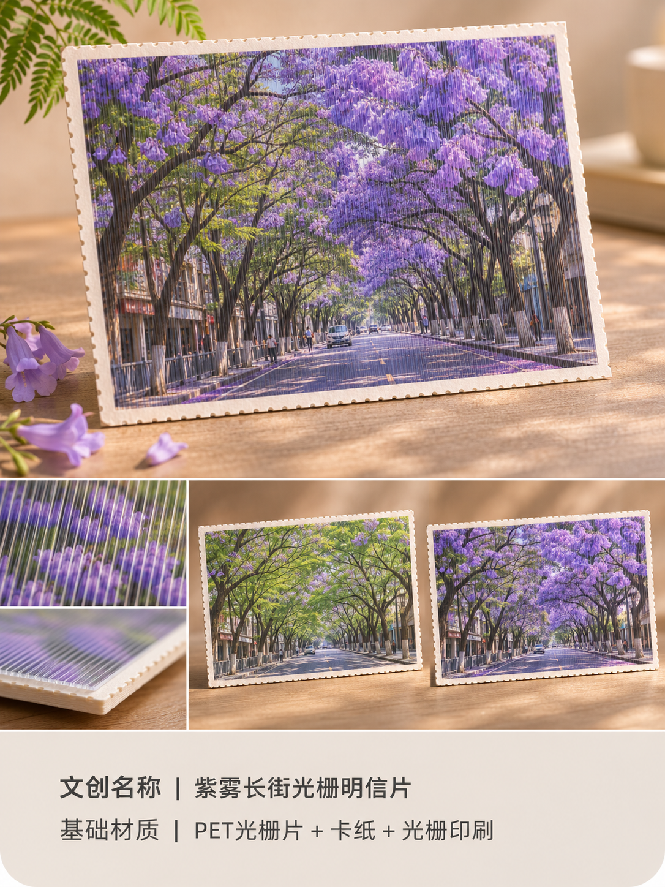</td>
    <td valign="top">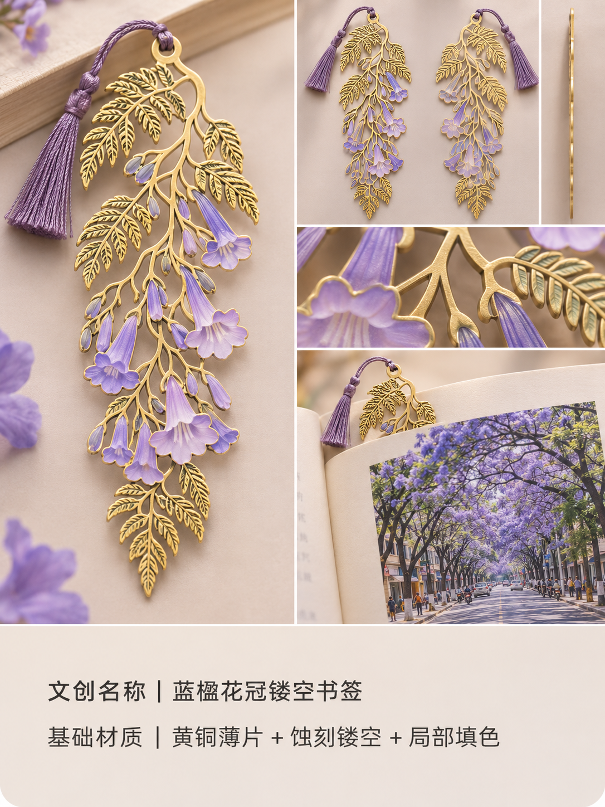</td>
  </tr>
  <tr>
    <td valign="top">PET 光栅片 + 卡纸 + 光栅印刷 角度切换初花与盛花 · 低中成本</td>
    <td valign="top">黄铜薄片 + 蚀刻镂空 + 局部填色 负形花序与羽状叶 · 低中成本</td>
  </tr>
  <tr>
    <td width="50%" align="center"><strong>蓝楹花铃陶瓷线香座</strong> 高质感居家款</td>
    <td width="50%" align="center"><strong>春城蓝楹花冠折叠伞</strong> 主推实用商品款</td>
  </tr>
  <tr>
    <td valign="top">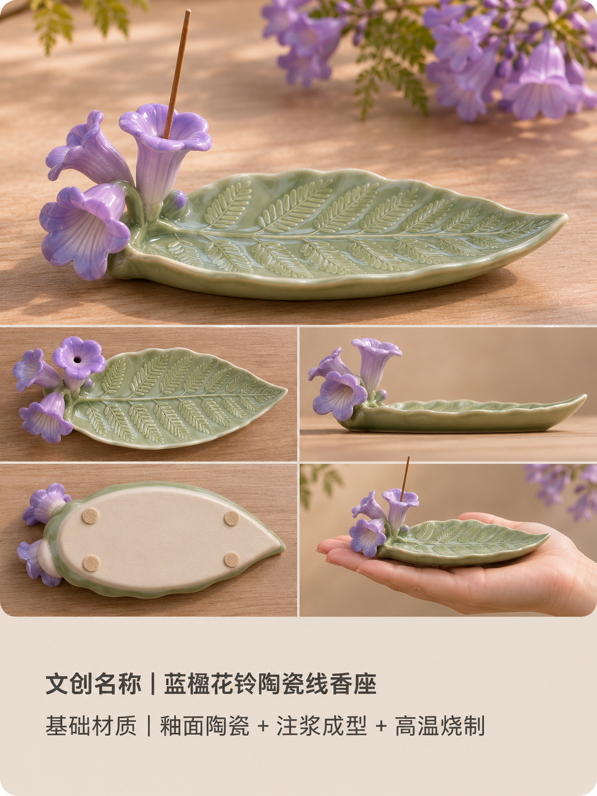</td>
    <td valign="top">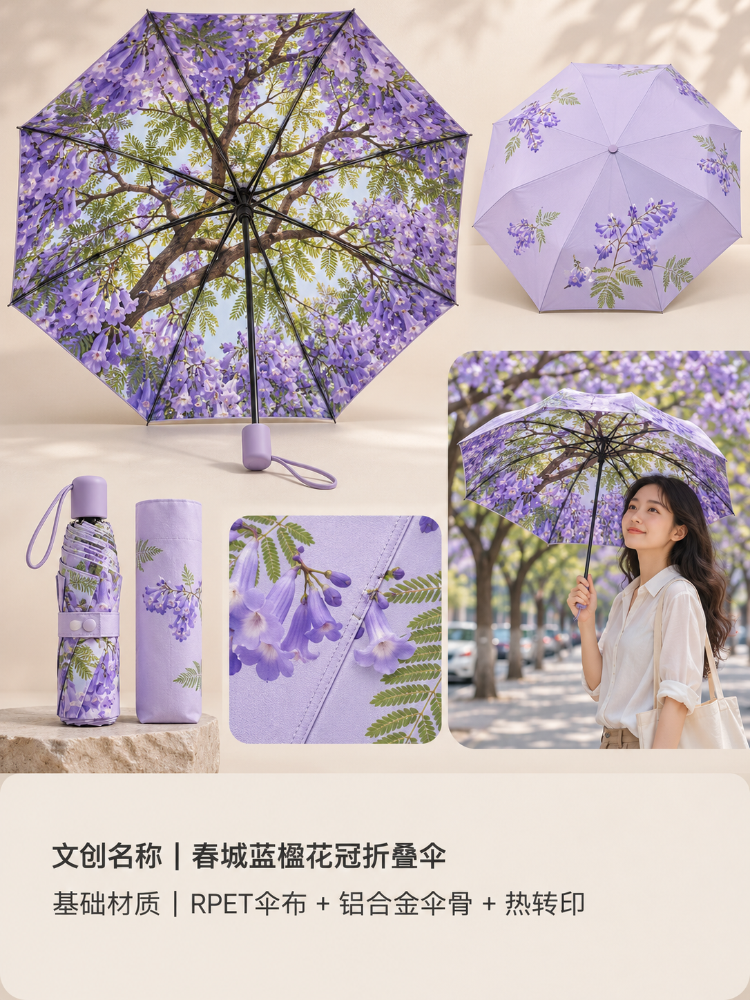</td>
  </tr>
  <tr>
    <td valign="top">釉面陶瓷 + 注浆成型 + 高温烧制 花冠转化为香孔 · 中等成本</td>
    <td valign="top">RPET 伞布 + 铝合金伞骨 + 热转印 伞下形成树冠视角 · 中等成本</td>
  </tr>
  <tr>
    <td width="50%" align="center"><strong>蓝楹枝梢珐琅胸针</strong> 入门价格带配饰</td>
    <td width="50%" align="center"><strong>蓝楹花廊木质拼插小景</strong> 礼盒陈列款</td>
  </tr>
  <tr>
    <td valign="top">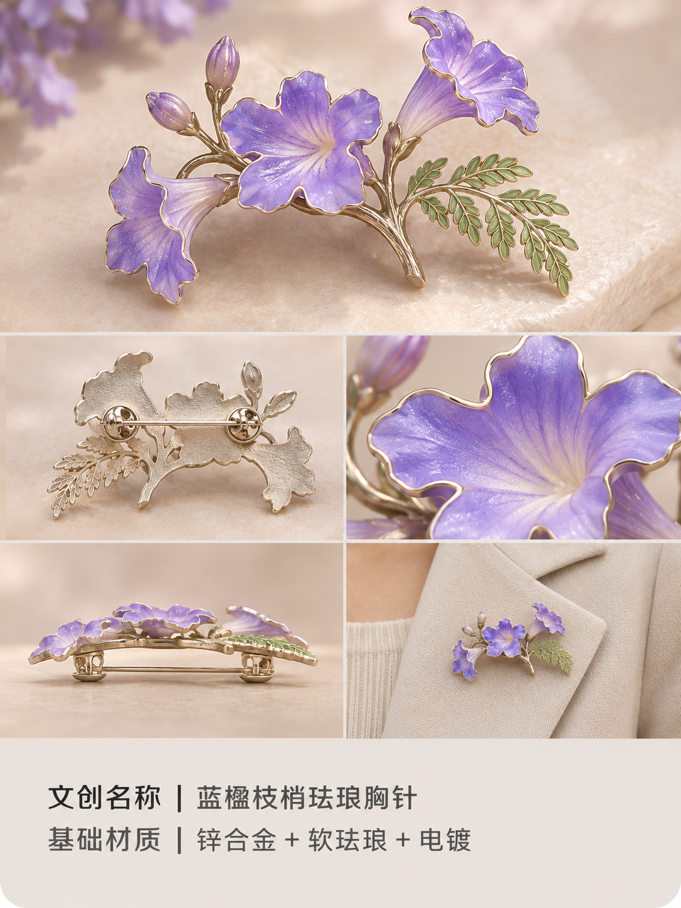</td>
    <td valign="top">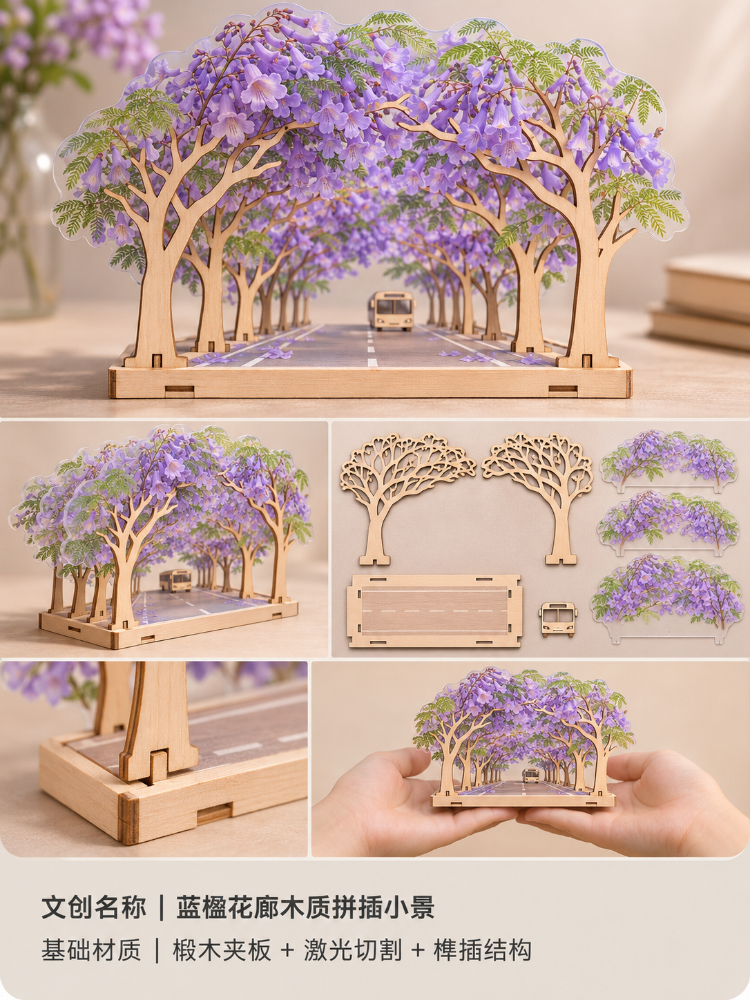</td>
  </tr>
  <tr>
    <td valign="top">锌合金 + 软珐琅 + 电镀 枝梢小型佩戴收藏 · 低中成本</td>
    <td valign="top">椴木夹板 + 激光切割 + 榫插结构 无胶拼装花廊 · 中等成本</td>
  </tr>
</table>

> 昆明案例采用两列并行展示。图片为概念效果图，不是可直接交厂的生产文件；正式生产前仍需完成尺寸、刀模、结构、分色和实物打样。

完整主体识别卡、选款逻辑和打样风险见 [`examples/kunming-jacaranda/README.md`](examples/kunming-jacaranda/README.md)。

## 能做什么

- 通过真实摄影与可靠资料核验主体，减少花卉、动物、建筑和具体个体的误画。
- 从 48 种产品与材质组合中建立候选池，避免只换图案、不换产品逻辑。
- 优先选择成熟、成本可控的纸品、陶瓷、金属、布艺、木制、香氛等工艺。
- 统一生成 3:4 产品概念图：上方约三分之二呈现产品，下方约三分之一标注名称和基础材质。
- 对学名、地方名和俗名进行同物异名核验，同一系列统一采用用户输入的主名称。

## 深圳三角梅案例

本组以深圳三角梅为同一文创主体，通过陶瓷、香氛石膏和木柄橡胶印章三条不同工艺路线，展示同一植物如何转化为不同成本与使用场景的产品。

<table>
  <tr>
    <td width="33.33%" align="center"><strong>一簇鹏城陶瓷冰箱贴</strong></td>
    <td width="33.33%" align="center"><strong>纸苞花影扩香牌</strong></td>
    <td width="33.33%" align="center"><strong>三角梅植物印章套组</strong></td>
  </tr>
  <tr>
    <td valign="top">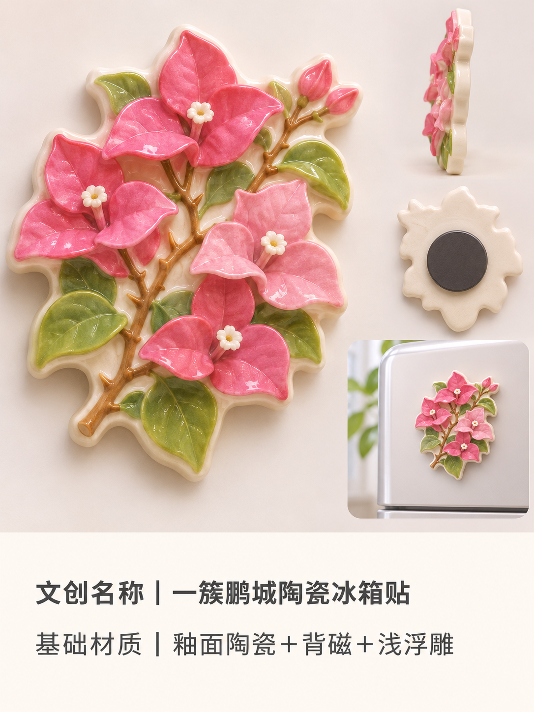</td>
    <td valign="top">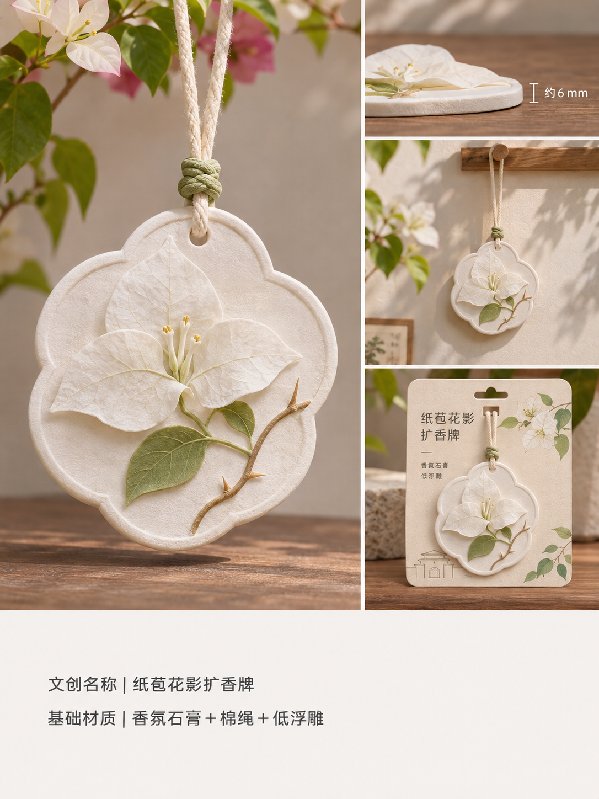</td>
    <td valign="top">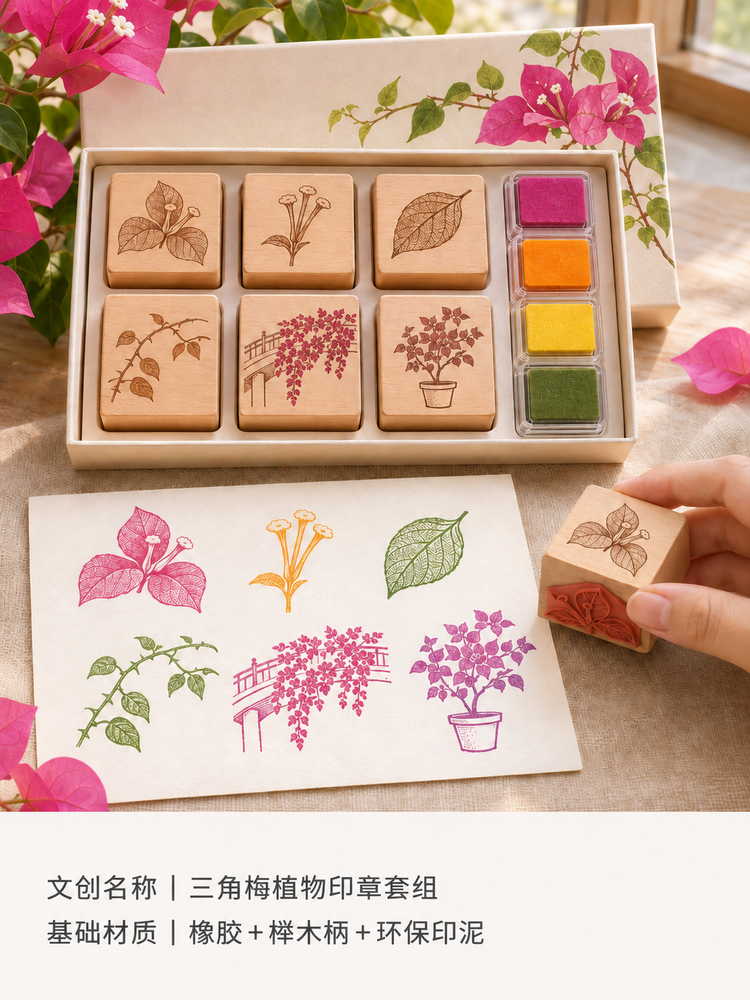</td>
  </tr>
  <tr>
    <td valign="top">釉面陶瓷＋背磁＋浅浮雕 核心旅游纪念品 · 中低成本</td>
    <td valign="top">香氛石膏＋棉绳＋低浮雕 家居香氛 · 低成本</td>
    <td valign="top">橡胶＋榉木柄＋环保印泥 互动纸品工具 · 中低成本</td>
  </tr>
</table>

> 图片为概念效果图。正式生产前仍需补充尺寸、色号、结构图、刀模图，并与供应商确认材料和工艺参数。

## 三星堆文创精选

本组不把文物图案简单印到不同载体上，而是把纵目、神树九鸟、金杖鱼鸟纹和大立人环握手势分别转化为纸艺互动、光影装置、传拓体验与线材收纳结构。

<table>
  <tr>
    <td width="50%" align="center"><strong>九鸟神树纸雕旋影灯</strong> 最有视觉冲击</td>
    <td width="50%" align="center"><strong>纵目显影机械明信片</strong> 最有传播创意</td>
  </tr>
  <tr>
    <td valign="top">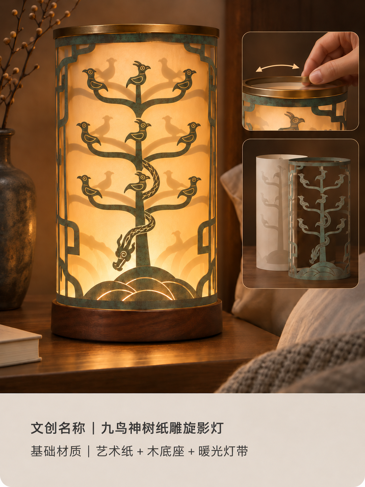</td>
    <td valign="top">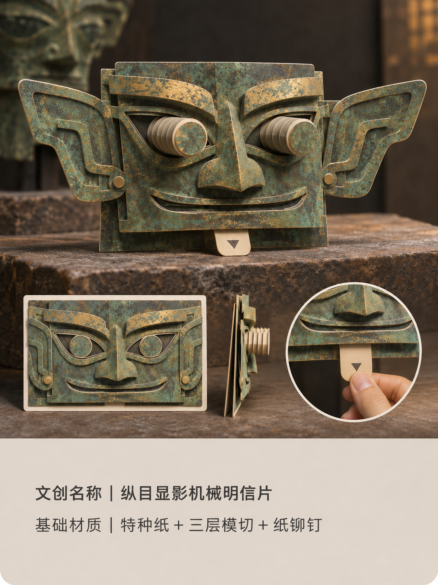</td>
  </tr>
  <tr>
    <td valign="top">艺术纸 + 木底座 + 暖光灯带 纸雕光影 · 中高成本概念款</td>
    <td valign="top">特种纸 + 三层模切 + 纸铆钉 抽拉互动 · 低至中成本</td>
  </tr>
  <tr>
    <td width="50%" align="center"><strong>鱼鸟金杖传拓卷</strong> 最有文化互动</td>
    <td width="50%" align="center"><strong>大立人环握理线器</strong> 最具实用商品感</td>
  </tr>
  <tr>
    <td valign="top">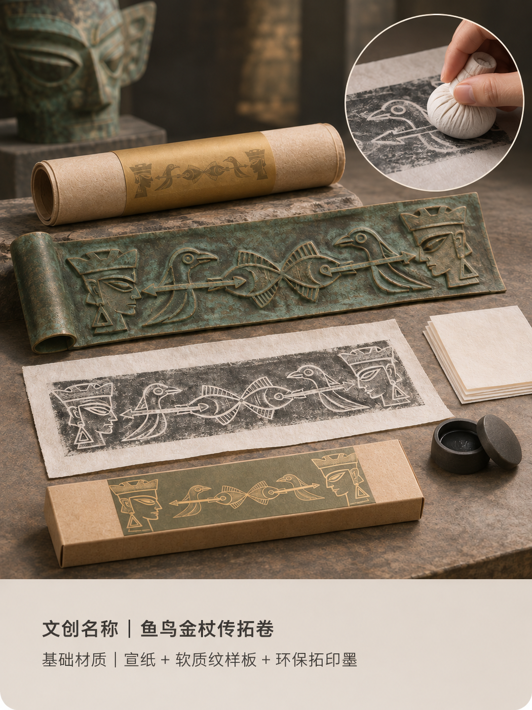</td>
    <td valign="top">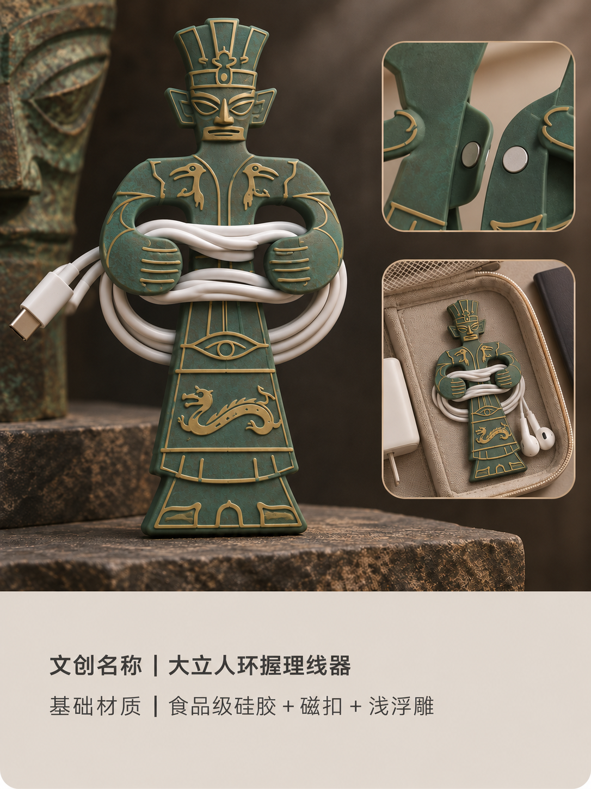</td>
  </tr>
  <tr>
    <td valign="top">宣纸 + 软质纹样板 + 环保拓印墨 参与式体验 · 低至中成本</td>
    <td valign="top">食品级硅胶 + 磁扣 + 浅浮雕 随身收纳 · 低至中成本</td>
  </tr>
</table>

> 三星堆案例采用两列并行展示；图片为概念效果图，正式生产前需继续验证纸艺结构、灯具安全、拓印线宽、磁扣强度及材料授权。

## 乌兰布和沙漠拟人 IP 案例

本组以用户提供的乌兰布和沙漠原创拟人 IP 为唯一角色母版，固定深红尖帽、额心红色旋纹、琥珀色大眼、红橙赭色服饰、青绿珠饰、骆驼挂件与发光金沙瓶等识别锚点，再把角色动作、服装轮廓和随身器物转化为可生产的产品结构。

<table>
  <tr>
    <td width="50%" align="center"><strong>金沙瓶流沙亚克力冰箱贴</strong> 互动主视觉款</td>
    <td width="50%" align="center"><strong>风帽旅人硅胶行李牌</strong> 旅行实用品</td>
  </tr>
  <tr>
    <td valign="top">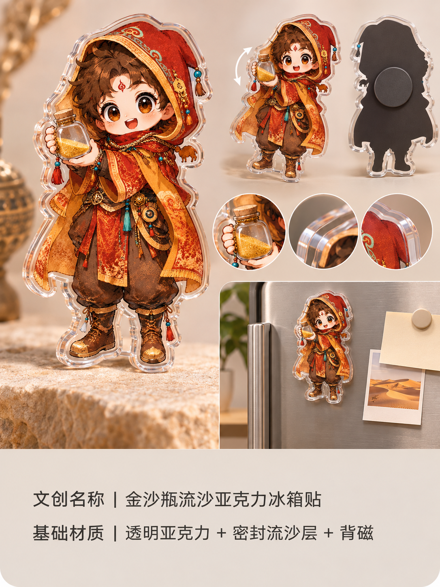</td>
    <td valign="top">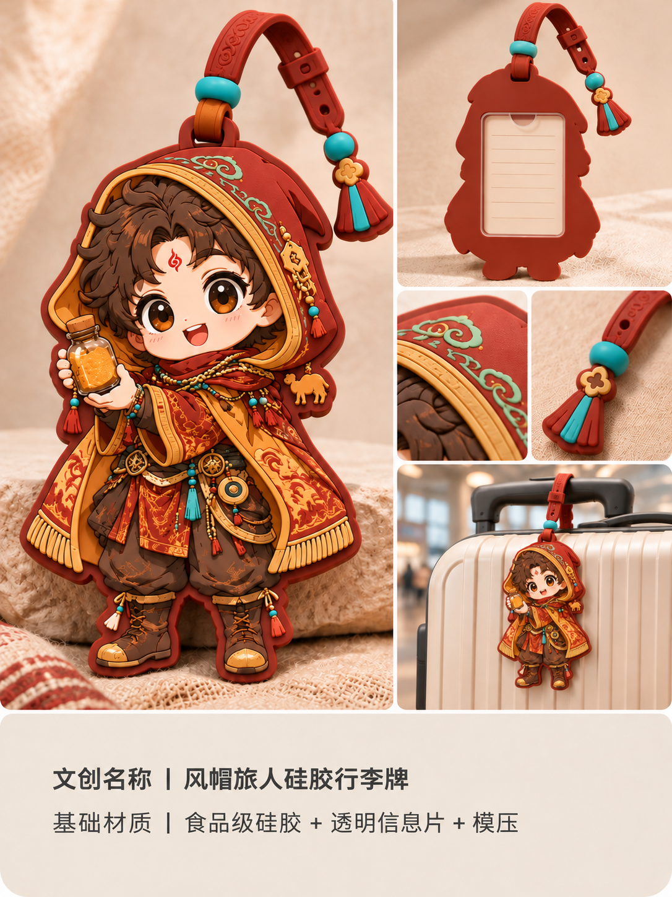</td>
  </tr>
  <tr>
    <td valign="top">透明亚克力 + 密封流沙层 + 背磁 动态结构 · 中高成本</td>
    <td valign="top">食品级硅胶 + 透明信息片 + 模压 旅行配件 · 中低成本</td>
  </tr>
  <tr>
    <td width="50%" align="center"><strong>守沙记忆半透明书签</strong> 轻量入门款</td>
    <td width="50%" align="center"><strong>驼铃风帽提花零钱包</strong> 实用商品款</td>
  </tr>
  <tr>
    <td valign="top">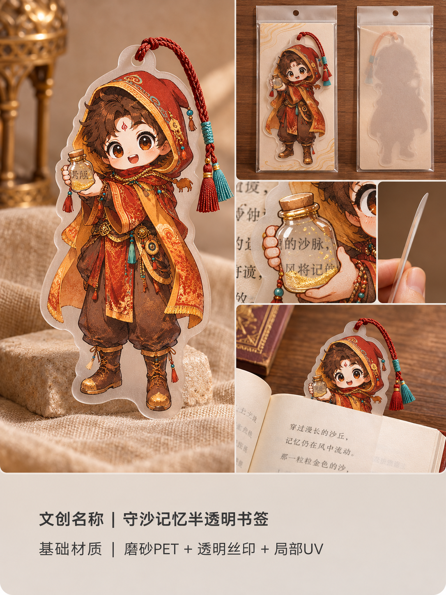</td>
    <td valign="top">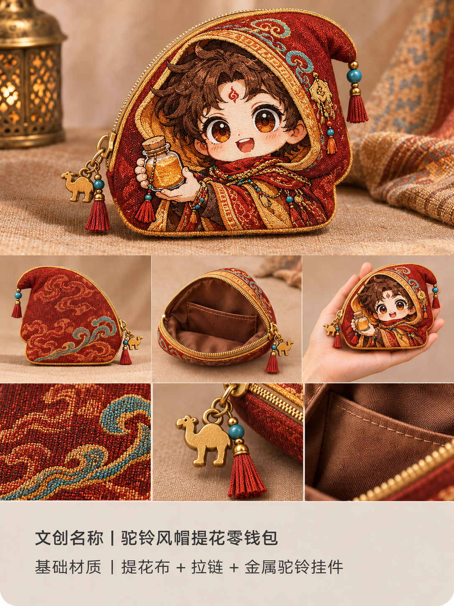</td>
  </tr>
  <tr>
    <td valign="top">磨砂 PET + 透明丝印 + 局部 UV 纸品周边 · 低成本</td>
    <td valign="top">提花布 + 拉链 + 金属驼铃挂件 布艺收纳 · 中等成本</td>
  </tr>
  <tr>
    <td width="50%" align="center"><strong>守沙旅人环抱手机支架</strong> 可拆装桌面用品</td>
    <td width="50%" align="center"><strong>披风沙丘三层立体明信片</strong> 可折平纸艺纪念品</td>
  </tr>
  <tr>
    <td valign="top">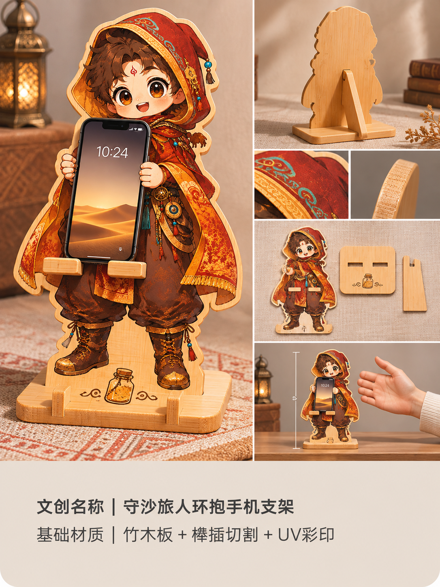</td>
    <td valign="top">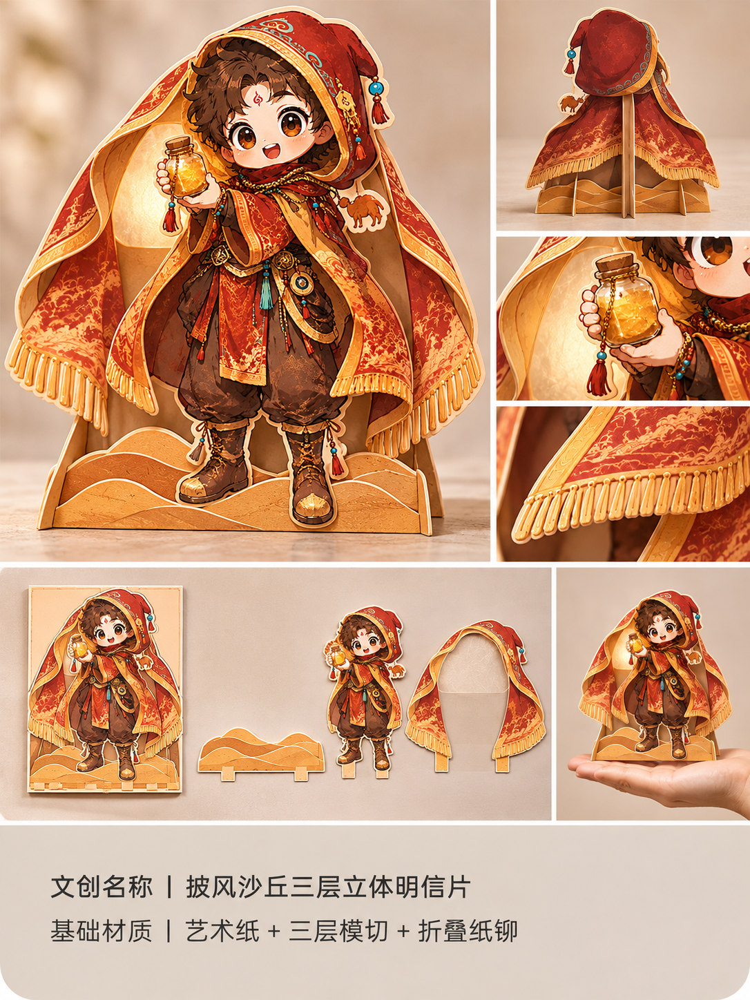</td>
  </tr>
  <tr>
    <td valign="top">竹木板 + 榫插切割 + UV 彩印 桌面用品 · 中低成本</td>
    <td valign="top">艺术纸 + 三层模切 + 折叠纸铆 立体纸艺 · 低至中成本</td>
  </tr>
  <tr>
    <td width="50%" align="center"><strong>乌兰布和旅途印章套组</strong> 文化互动款</td>
    <td width="50%" align="center"><strong>守沙三件珐琅胸针组</strong> 可拆售配饰款</td>
  </tr>
  <tr>
    <td valign="top">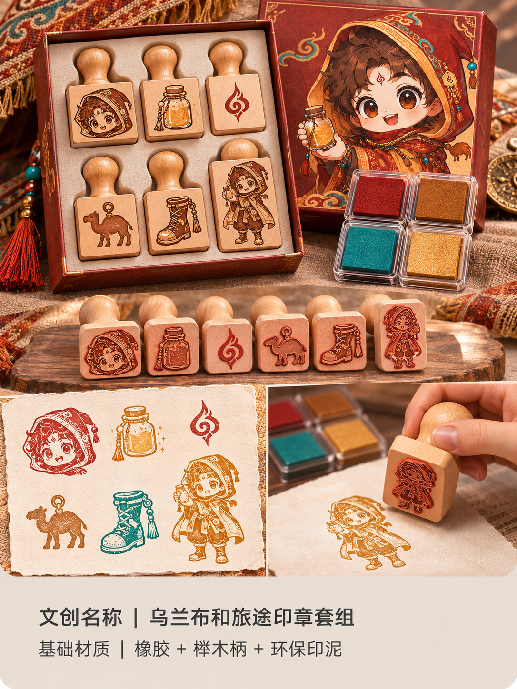</td>
    <td valign="top">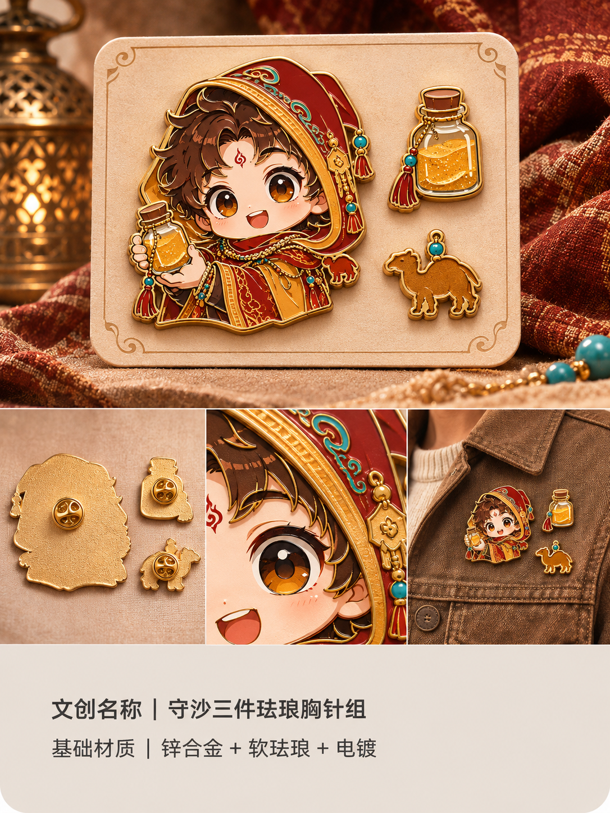</td>
  </tr>
  <tr>
    <td valign="top">橡胶 + 榉木柄 + 环保印泥 手账互动 · 中低成本</td>
    <td valign="top">锌合金 + 软珐琅 + 电镀 随身配饰 · 中等成本</td>
  </tr>
</table>

> 原创 IP 案例采用两列并行展示。图片为概念效果图，不构成生产结构图；正式打样前需继续验证流沙腔体密封、硅胶薄位强度、提花精度、榫插稳定性、印章线宽和珐琅隔线。

更完整的角色锚点、选款建议和打样注意事项见 [`examples/wulan-buh-ip/README.md`](examples/wulan-buh-ip/README.md)。

## 工作方式

1. 核验主体、地域、真实色彩与不可画错的结构。
2. 从产品与材料库建立不少于 12 款内部候选。
3. 按品类差异、制造难度、成本与销售场景筛选。
4. 为每款产品分别生成独立概念图并逐项验收。
5. 输出产品类型、主体转化逻辑、基础材质、成本层级与量产风险。

详细规则见 [`SKILL.md`](SKILL.md)，产品与材质组合见 [`references/product-material-library.md`](references/product-material-library.md)。

## 许可与商业授权

本项目采用自定义的个人非商业使用许可。个人学习、研究和非商业创作可以免费使用；收费服务、客户项目、企业生产、营销推广、付费培训、商业产品集成及其他直接或间接商业用途，均需事先取得书面授权。

商业授权请通过 [GitHub Issues](https://github.com/dorlarosendo434-hub/cultural-merch-designer/issues/new) 联系作者，并说明使用场景、发布渠道和预计范围。完整条款见 [`LICENSE.md`](LICENSE.md)。

## 关注与交流

欢迎关注公众号，获取文创设计、文旅产品、视觉案例和 AI Skill 实操分享；也可以添加微信进群，交流文创设计与 AI 创作工作流。非诚勿扰。

添加微信时，日常交流请备注 **「AI交流」**；商业授权请备注 **「文创授权」**，并说明使用场景、发布渠道和预计范围。

<table>
  <tr>
    <td width="50%" align="center"><strong>添加微信</strong> 日常交流备注「AI交流」；商业合作备注「文创授权」 </td>
    <td width="50%" align="center"><strong>关注公众号</strong> 获取文创设计与 Skill 实操案例 </td>
  </tr>
</table>
